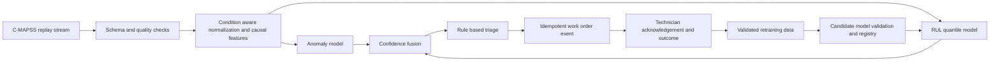

# C-MAPSS Predictive Maintenance Implementation Plan

## 1. Objective

Build an automated predictive-maintenance proof of concept for the NASA C-MAPSS turbofan fleet dataset. The system ingests telemetry, validates and transforms it, identifies abnormal behaviour, estimates Remaining Useful Life (RUL), applies deterministic triage rules, and creates a maintenance work-order event. Human review is reserved for uncertain, stale, or conflicting cases.

The first working release uses FD001. The same workflow then scales to FD002, FD003, and FD004.

## 2. Problem framing

Each C-MAPSS row is one engine observation at one cycle:

- unit number
- cycle number
- three operational settings
- 21 sensor readings

The dataset is multivariate engine telemetry, not high-frequency vibration data. The solution must therefore use time-series and operating-condition features rather than FFT or bearing-frequency features.

The core outputs are:

1. An anomaly score indicating deviation from learned healthy operation.
2. An RUL prediction in cycles, including an uncertainty interval.
3. A triage level and a work-order event when action is required.

## 3. Dataset scope and controls

### 3.1 Delivery sequence

| Stage | Dataset | Reason |
| --- | --- | --- |
| Baseline | FD001 | One operating regime and one fault mode; fastest way to validate the pipeline. |
| Condition scaling | FD002 | Six operating regimes and one fault mode. |
| Fault robustness | FD003 | One operating regime and two fault modes. |
| Final challenge | FD004 | Six operating regimes and two fault modes. |

### 3.2 Label construction

For every training engine, calculate the RUL target as:

    RUL at cycle k = last observed training cycle for that engine - k

Use the supplied test RUL files only for final evaluation. For a test engine, the prediction of interest is the RUL at its final observed cycle.

### 3.3 Leakage prevention

- Split data by engine ID, never by random rows or cycles.
- Fit scalers, feature selectors, and thresholds on training engines only.
- Use past-only rolling windows. Do not use centred rolling windows or features that depend on future cycles.
- Preserve engine order in replay mode.

### 3.4 Data-quality handling

The supplied files contain no missing numerical values, but the production-style pipeline must still detect and handle:

- invalid schema or column count
- duplicate engine-cycle events
- missing sensor values
- stale or out-of-order cycles
- unrealistic sensor range or rate-of-change values
- long gaps in a unit's stream

Data-quality status becomes an input to triage. A low-quality event must not silently generate a high-confidence maintenance action.

## 4. Target architecture



### 4.1 Streaming data plane

1. A replay service emits one engine-cycle record at a time from the selected C-MAPSS file.
2. The quality gate validates the record and stores only state required for that engine.
3. The feature service updates causal rolling statistics.
4. The anomaly and RUL models perform inference.
5. The fusion and triage service emits an action or an exception.
6. The work-order service writes a deduplicated maintenance event.

### 4.2 Governed model plane

1. Track data version, feature configuration, model parameters, metrics, and artifacts in MLflow.
2. Treat every retrained model as a candidate.
3. Validate candidates on an engine-wise holdout set using RMSE and NASA asymmetric score.
4. Promote only a candidate that meets agreed improvement and safety checks.
5. Deploy with model version, canary cohort, rollback path, and audit log.

## 5. Data engineering

### 5.1 Feature pipeline

For each engine, build features using only the current and previous observations:

- selected raw sensor values and operating settings
- rolling mean, standard deviation, minimum, and maximum
- slope over a recent window
- first difference and change rate
- elapsed cycle and window completeness
- operating-condition cluster or settings-aware normalisation

Remove constant or near-constant sensors separately for each subset. For FD001, sensors s1, s5, s6, s10, s16, s18, s19 are near-constant and should be dropped. Research paper 1 (Ramasso & Saxena 2014) identifies sensors {7, 8, 9, 12, 16, 17, 20} as the most commonly used informative subset. Use `sensor_trend_evidence()` from `cmapss_analysis.py` to make the final selection data-driven per subset. Apply feature selection only after the training split is fixed.

### 5.2 Normalisation

FD002 and FD004 contain multiple operating regimes. Use K-Means clustering (K=6, matching the documented six operating conditions) on the three rounded settings columns to identify operating conditions, then z-normalise sensor features per cluster. The `_rounded_setting_keys()` utility in `cmapss_analysis.py` and `setting_effect_evidence()` already support this. This prevents normal load or operating variation from being treated as degradation.

### 5.3 State management

Keep a small per-engine state object:

    engine_id
    last_cycle
    rolling buffers
    normalisation context
    anomaly persistence count
    last work-order idempotency key

This supports one-record-at-a-time processing without loading future data.

## 6. Machine-learning design

### 6.1 RUL model

Start with a transparent baseline using causal engineered features:

- Random Forest or HistGradientBoosting regressor as a benchmark
- gradient-boosted quantile models for P10, P50, and P90 RUL estimates
- small MLP regressor as the compact neural baseline

Use a capped RUL target of 125 cycles (the de facto C-MAPSS literature convention). This piecewise-linear target reduces noise on long-lived early-life engines without affecting ranking near failure. The cap is exposed as a configurable hyperparameter in `config.py`. Both capped and uncapped results should be reported for transparency.

Target benchmark range for FD001: RMSE 12–18 cycles (published baselines with engineered features and gradient boosting).

### 6.2 Anomaly model

Train a compact autoencoder on healthy-reference windows, for example early lifecycle windows from training engines. Use reconstruction error as a novelty score.

The anomaly score is an early-warning signal, not a substitute for RUL. C-MAPSS does not provide per-cycle anomaly labels, so do not report generic anomaly-classification accuracy. Evaluate anomaly behaviour through early-warning lead time, false alerts per engine, persistence, and agreement with RUL deterioration.

### 6.3 Confidence fusion

The model output should include:

    anomaly_score
    anomaly_persistence
    rul_p10
    rul_p50
    rul_p90
    prediction_interval_width
    data_quality_status
    model_version

The fusion service uses uncertainty, persistence, and data quality to decide whether an action is safe to automate.

## 7. Rule-based triage agent

| Level | Example decision rule | Action |
| --- | --- | --- |
| L0 Monitor | Good data quality, low anomaly score, and P10 RUL above planning horizon | Continue monitoring. |
| L1 Inspect | Anomaly remains elevated for a configured number of cycles | Create an inspection recommendation. |
| L2 Plan | Persistent anomaly and P10 RUL below planning threshold | Create planned-maintenance work order. |
| L3 Critical | Strong persistent anomaly and P90 RUL below critical threshold | Create high-priority work order. |
| Exception | Missing, stale, conflicting, or high-uncertainty evidence | Send to human review. |

Thresholds must be calibrated on validation engines and exposed through configuration, not embedded in source code.

### 7.1 Work-order event schema

```json
{
  "work_order_key": "asset_id:severity:time_bucket",
  "asset_id": "engine_042",
  "timestamp": "cycle_183",
  "severity": "L2",
  "recommended_action": "planned inspection",
  "anomaly_score": 0.91,
  "rul_interval_cycles": [24, 38, 56],
  "data_quality": "good",
  "evidence_window": "last_30_cycles",
  "model_version": "rul-v0.3.0"
}
```

The event is idempotent: repeated replay records update or reference the existing event rather than create duplicate work orders.

## 8. MLOps and monitoring

Track the following in MLflow and the dashboard:

- dataset subset and checksum
- feature-set version and selected sensors
- train/validation engine IDs
- RUL RMSE, MAE, NASA asymmetric score (where `score = sum(exp(-d/13) if d<0 else exp(d/10) - 1)` for each engine's prediction error d), and interval coverage for quantile models
- anomaly threshold, alert rate, persistence, lead time, and false alerts per engine
- data-quality failure rate and schema errors
- feature drift, reconstruction-error drift, RUL distribution, and model version
- work orders by severity, acknowledgement, and outcome

Retraining requires a controlled trigger, such as verified maintenance outcomes, meaningful drift, or a scheduled batch. It must never train blindly from its own predictions.

## 9. Optional edge deployment

The ESP32 work is relevant as an edge-inference pattern, but it is a different task from C-MAPSS RUL prediction.

### 9.1 Suitable edge design

Use a compact input vector of selected causal telemetry features, not the earlier vibration feature vector. A viable shared model is:

    32 features -> encoder 16 -> latent 8
    latent 8 -> decoder 16 -> 32 features       # anomaly reconstruction
    latent 8 -> RUL head 8 -> P10/P50/P90       # RUL interval

Train centrally, then quantise to int8 using post-training quantisation or, preferably, quantisation-aware training. Measure flash, RAM, latency, and accuracy on the actual target device before making size or latency claims.

### 9.2 Controlled adaptation policy

Every new record receives inference. The device may:

- update running healthy-reference statistics within strict bounds
- buffer uncertain or out-of-distribution records
- report model confidence and drift

The device must not retrain the full model on every record. A RUL prediction error is unavailable until a future failure or trusted maintenance outcome supplies ground truth. Full retraining belongs in the governed central workflow; a validated model is then redeployed to the device.

## 10. Delivery plan

| Period | Deliverable | Acceptance criteria |
| --- | --- | --- |
| Days 1-2 | FD001 loader, schema, labels, engine-wise split, replay service | Reproducible replay and no cycle leakage. |
| Days 3-4 | Causal feature pipeline and RUL baseline | Logged engine-wise validation metrics. |
| Days 5-6 | Autoencoder, RUL intervals, confidence fusion | Anomaly and RUL outputs available per stream event. |
| Days 7-8 | Triage, idempotent work-order service, Streamlit dashboard | Live replay visibly produces decisions and evidence. |
| Days 9-10 | MLflow model registry and retraining demonstration | Candidate model is validated, promoted or rejected, and auditable. |
| After baseline | FD002, FD003, FD004 support | Condition-aware scaling and subset-specific evaluation. |

## 11. Demonstration script

1. Select FD001 and start the replay.
2. Show data-quality status and rolling features for one engine.
3. Show anomaly score, RUL interval, and confidence changing cycle by cycle.
4. Trigger an L1/L2 triage state and display its evidence.
5. Show the created work-order event and confirm duplicate prevention.
6. Show MLflow experiment results and engine-wise validation metrics.
7. Demonstrate a candidate retraining run and promotion decision.
8. Explain how the same configuration scales to FD004.

## 12. Siemens prior-work positioning

Use the following description only where it is factually accurate:

> During my Siemens internship, I worked on a related edge predictive-maintenance prototype for pump fault classification. I engineered vibration features from multiple pump families and mounting conditions, compared several models, and deployed a quantised TinyML classifier to an ESP32-S3. The live workflow streamed observations to the board, performed local inference, returned predictions, and logged results. For this C-MAPSS case study, I am transferring the deployment, streaming, anomaly, and governed-update ideas while redesigning the features and model for RUL regression.

Do not claim that the pump prototype's vibration features, fault classes, accuracy, model size, or latency are C-MAPSS results. The C-MAPSS design must be evaluated independently.

## 13. Completion criteria

The proof of concept is complete when it:

- processes the selected C-MAPSS subset end-to-end without manual data steps
- creates causal features and produces RUL estimates for each replayed engine-cycle
- records credible engine-wise RUL evaluation metrics
- exposes anomaly, uncertainty, data quality, and model version in the dashboard
- creates correct deduplicated maintenance events through deterministic triage rules
- demonstrates a governed candidate-retraining and rollback-capable deployment path
- clearly separates validated C-MAPSS outcomes from prior Siemens pump-prototype results

